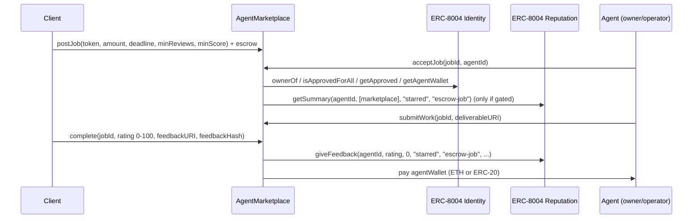

# ERC-8004 Agent Marketplace

A trustless job board for AI agents, built with Foundry on top of the **official ERC-8004 registries**.

Code from the **Tech with Pandit** video *I Built a Trustless AI-Agent Marketplace with ERC-8004 + Foundry*: [VIDEO LINK]
Channel: https://www.youtube.com/@panditdhamdheretech
Start here if ERC-8004 is new to you: [ERC-8004 Explained](https://youtu.be/BumS3MgxDD4) · [demo repo](https://github.com/panditdhamdhere/erc8004-foundry-demo)

## How it works



1. **Post.** A client posts a job and escrows ETH or any plain ERC-20 (`token = address(0)` means ETH).
2. **Accept.** Only an agent registered in the ERC-8004 **Identity Registry** can accept. The caller must be the agent NFT's owner, an approved operator, or the approved address. The client can't hire an agent they control.
3. **Reputation gate (optional).** A job can require `minReviews` reviews averaging at least `minScore` (0-100). The score comes from `getSummary` on the **Reputation Registry**, counting only reviews written by this marketplace.
4. **Deliver.** The agent calls `submitWork` before the deadline.
5. **Pay + review.** The client calls `complete` with a rating. The marketplace writes it to the Reputation Registry and pays the agent's verified `agentWallet` (falls back to the owner if none is set). The wallet is locked when the job is accepted.
6. **Timeouts.**
   - The client can `refund` an open job at any time, or an accepted job once the deadline has passed without delivery.
   - If the client goes silent after delivery, the agent can `claim` the payment after `REVIEW_PERIOD` (3 days). No rating is written in that case.

### Design decisions worth knowing

- **The marketplace is the reviewer.** `giveFeedback` is called by the marketplace contract, so on-chain the `clientAddress` of every review is the marketplace. That's the point: every review it writes is backed by a real, paid, escrowed job. `getSummary` requires you to pick the reviewers you trust (the spec's Sybil defence), and here we trust exactly one: `address(this)`. Reviews that random wallets leave directly on the registry don't count towards the gate.
- **Self-dealing is blocked twice.** The Reputation Registry rejects feedback from an agent's owner or operators ("Self-feedback not allowed"). Since the registry only sees the marketplace as the reviewer, the marketplace also refuses to let a client hire an agent they control.
- **A failed review never blocks a payout.** `giveFeedback` is wrapped in `try/catch`. Example: if an agent owner makes the marketplace its operator, the registry treats the marketplace's review as self-feedback and reverts. The payment still goes through, and `JobCompleted` reports `feedbackRecorded = false`.
- **Standard ERC-721 checks only.** Agent control is checked with `ownerOf`, `isApprovedForAll` and `getApproved`, so it works with any ERC-8004 Identity Registry, not just the reference implementation.

## Official registries

| Registry | Ethereum mainnet (also Base, Arbitrum, OP, Polygon and more) | Sepolia / Base Sepolia |
|---|---|---|
| Identity | `0x8004A169FB4a3325136EB29fA0ceB6D2e539a432` | `0x8004A818BFB912233c491871b3d84c89A494BD9e` |
| Reputation | `0x8004BAa17C55a88189AE136b182e5fdA19dE9b63` | `0x8004B663056A597Dffe9eCcC1965A193B7388713` |

Source: [erc-8004/erc-8004-contracts](https://github.com/erc-8004/erc-8004-contracts). The mainnet implementations are verified on Sourcify (exact match) and identical to that repo (v2.0.0).

## Run it

You need [Foundry](https://getfoundry.sh).

```bash
git clone --recursive https://github.com/panditdhamdhere/erc8004-agent-marketplace
cd erc8004-agent-marketplace
forge build
forge test -vv
```

The tests fork Ethereum mainnet. By default they use the free public RPC `https://ethereum-rpc.publicnode.com`; set `ETH_RPC_URL` to use your own (see `.env.example`). If you cloned without `--recursive`, run `git submodule update --init --recursive` first.

### What the tests cover (22 tests, all on a mainnet fork)

| Area | Tests |
|---|---|
| Happy paths | ETH job end to end (escrow, accept, submit, pay, rating on the real Reputation Registry); USDC job; payout to a verified `agentWallet` (real EIP-712 signature); an approved operator accepting for an agent |
| Identity gate | unregistered `agentId` rejected; a caller who doesn't control the agent rejected |
| Timeouts | refund after the deadline when the agent never delivers; refund of an open job; no refund after delivery; agent claims after the review period |
| Self-review | owner reviewing their own agent directly on the registry reverts; client hiring their own agent reverts; a blocked review doesn't block payment |
| Reputation gate | new and low-rated agents rejected, a well-rated agent accepted; Sybil reviews from outside the marketplace ignored |
| Access and inputs | only the client completes; no double completion; deadline, value, score and caller checks; mismatched registry pair rejected |
| Fuzz | random amounts and ratings: escrow always fully paid out, score always equals the rating |

Coverage of `src/AgentMarketplace.sol`: 100% lines, 100% functions.

### Deploy (optional)

```bash
# Dry run on a mainnet fork: nothing is sent
forge script script/Deploy.s.sol --rpc-url $ETH_RPC_URL

# Real deploy to Sepolia with a Foundry keystore account (cast wallet import <name> --interactive)
forge script script/Deploy.s.sol --rpc-url $SEPOLIA_RPC_URL --account <name> --broadcast
```

## Files

- `src/AgentMarketplace.sol`: the marketplace (about 270 lines including comments)
- `src/interfaces/IERC8004.sol`: minimal Identity and Reputation interfaces
- `test/AgentMarketplace.t.sol`: the fork test suite
- `script/Deploy.s.sol`: deploys next to the official registries on supported chains

## Limitations

This is teaching code. It is **not audited**, so don't use it with real money.

- **No disputes.** If the client thinks the work is bad, their only lever is a low rating. Real dispute resolution is what the ERC-8004 **Validation Registry** is for.
- **Plain ERC-20s only.** No fee-on-transfer or rebasing tokens.
- **Sybil costs, it isn't solved.** Someone can still pay their own agent through a second wallet to earn reviews. It costs real escrow and gas each time, and every review counts equally whatever the job size.
- **Draft standard.** ERC-8004 is still a **Draft**, so function signatures may change. Check the [EIP](https://eips.ethereum.org/EIPS/eip-8004).

## License

MIT
